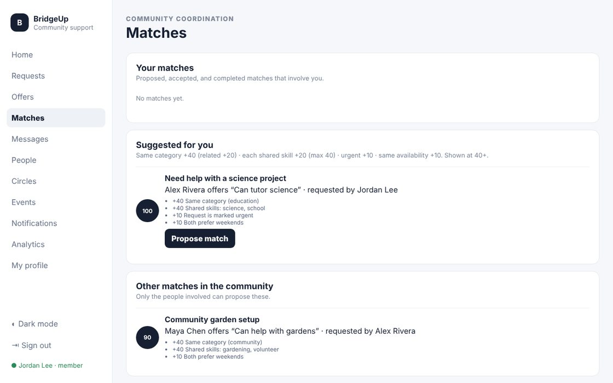

# BridgeUp V7

BridgeUp is a community-support platform built for the CSC Winter Sparkathon. It connects people who need help with people who can offer a skill, explains every suggested match, and keeps people safe with consent-based messaging, blocking, reporting, and moderation.



## My role & contributions

**Solo developer · AI-assisted**

- Designed the safety model: messaging opens only after both people agree, plus blocking, reporting, and moderation
- Defined the matching weights and made every match show its reasons
- Tested with three users signed in at once (student, tutor, moderator)

## What's in V7
- **Real accounts:** scrypt-hashed passwords, HttpOnly SameSite=Strict session cookies, sign-in rate limiting, and same-origin checks on every write.
- **Roles enforced on the server:** member, helper, moderator, and admin. Only an author or a moderator can edit or remove a post. Only moderators can see the report queue and audit log.
- **SQLite database** using Node's built-in `node:sqlite`. No native add-ons are needed. It has foreign keys, transactions, and unique constraints (one report per person per item, one match per request/offer pair).
- **Explainable matching:** same category +40 (related +20), each shared skill +20 (max 40), urgent +10, same availability +10. Every suggestion lists its reasons.
- **Match workflow:** propose → accept or decline → complete. Accepting marks the request as matched, and completing closes it.
- **Private messaging:** you can only message someone after an accepted match or connection. Only the two participants can read a conversation. There are rate limits and a 2-link cap to slow spam.
- **Live updates:** notifications and messages arrive instantly via Server-Sent Events. No polling and no extra packages.
- **Safety:** block anyone (hides them and stops messages), report posts, messages, or people. Moderators can dismiss, remove content, or suspend the author (which revokes sessions). Every action goes to an audit log, and the reporter is notified.
- **Circles and events** with real membership and RSVPs. **Analytics** from live data, including which requests still have no helper.
- Accessible UI: skip link, `aria-current` navigation, labeled inputs, visible focus rings, dark mode, and a responsive top navigation on phones.

## Run (Node.js 22.13 or newer)
```bash
npm install
npm --prefix client install
npm run dev            # API on :5000 and the app on http://localhost:5173
```
Production-style run on one port: `npm start`, then open http://localhost:5000.

**Demo accounts** (fictional) all use the password `bridgeup-demo-2026`: `jordan` (student), `alex` (tutor), `maya` (helper), `sam_mod` (moderator). The sign-in screen has one-click buttons for each.

To reset the demo data, delete `server/data/bridgeup.db*`.

## Tests
```bash
npm test     # 9 API and unit test groups: auth, authorization, matching, messaging rules, blocking, moderation, suspension, rate limits
```

## Known limits
- One server process. Live updates are held in memory, so a multi-server deployment would need a shared pub/sub service.
- Messages are protected by access control and HTTPS in transit, but they are not end-to-end encrypted.
- No email verification or password reset yet.
- `node:sqlite` is marked experimental by Node. The `start` scripts silence that warning.

## License

**Permission required.** © 2026 Dagmawi Melaku. You need my written permission before using, copying, or modifying this code, and any approved use must credit me with a link to this repository. Viewing, forking on GitHub, and running it to judge or review a submission are allowed without asking. To ask, [open an issue](../../issues/new). See [LICENSE](LICENSE) for the full terms.

## Earlier versions

Previous uploads of this project are kept unchanged in [`archive/`](archive/).
